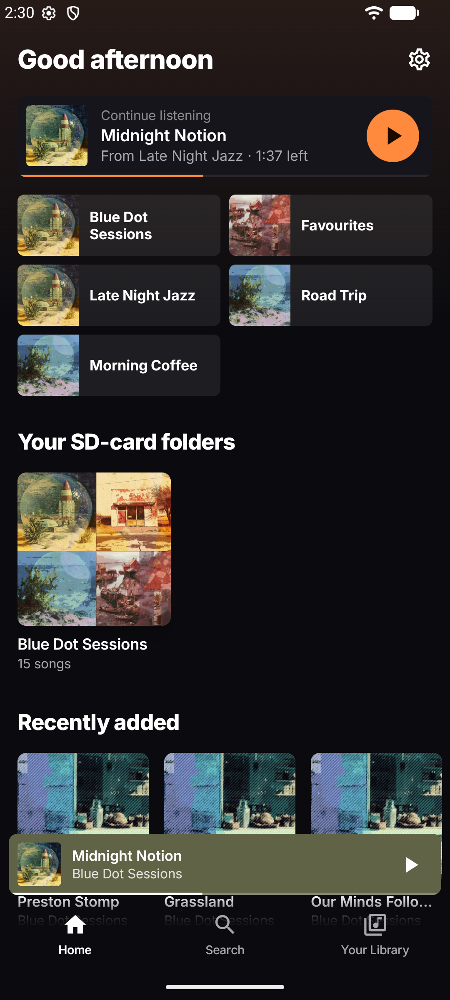
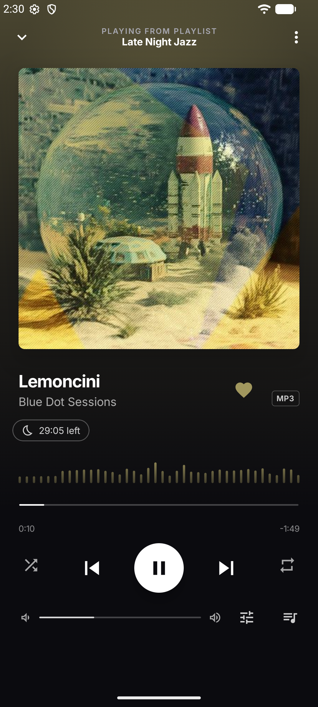
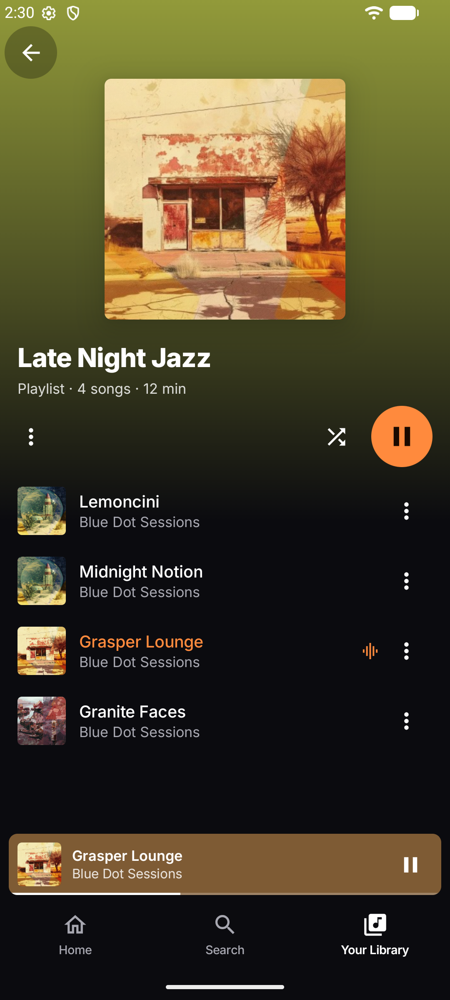
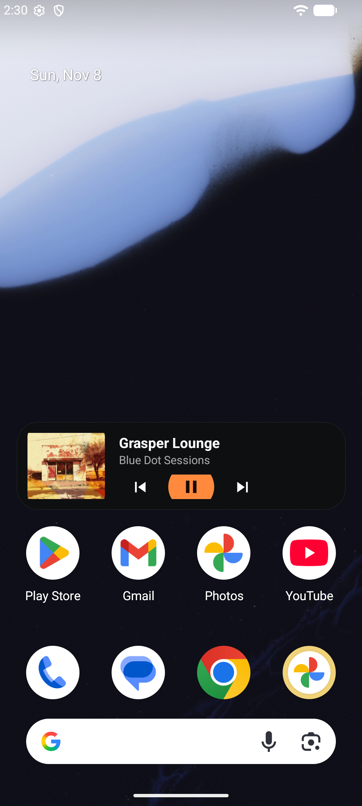
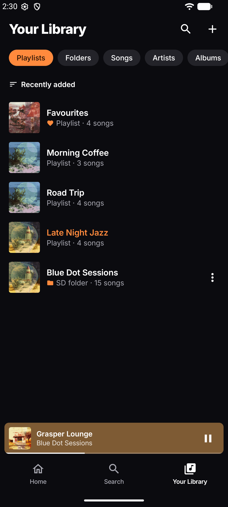
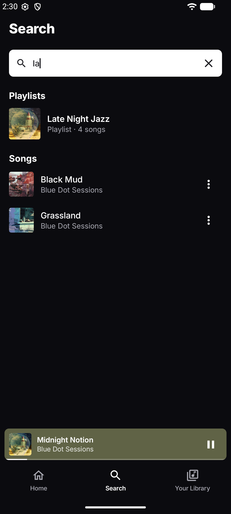
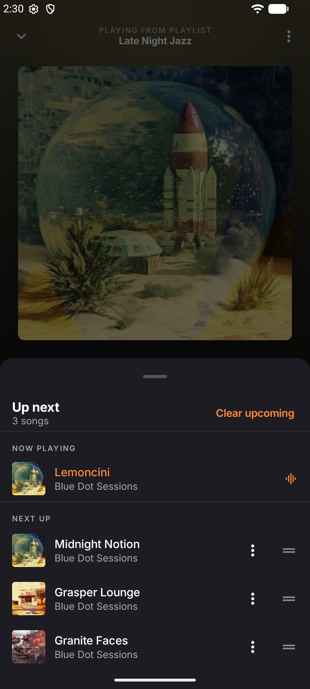
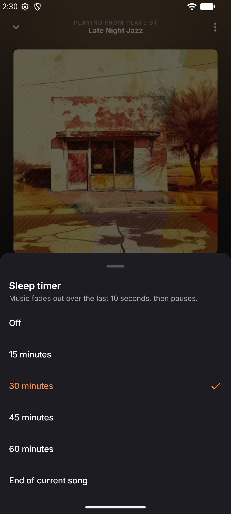
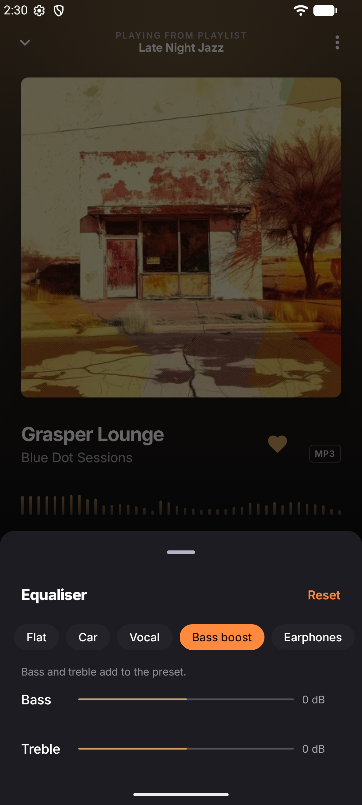
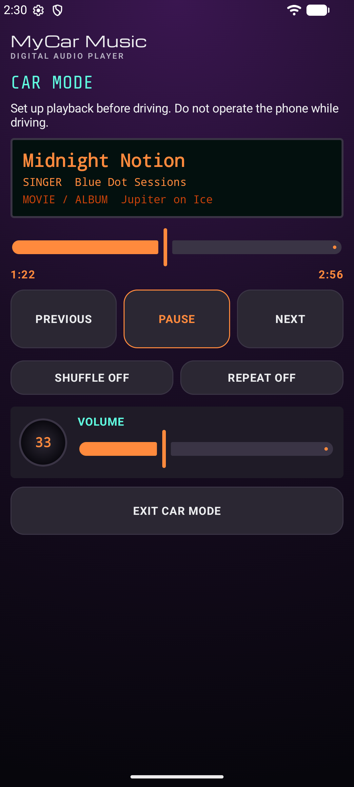

  

<h1 align="center">MyCar Music</h1>

  <b>A beautiful offline music player for the songs you already own — at home and in the car.</b>

  <a href="https://github.com/Maukingdomctrl/music-player/releases/latest"><b>Download the APK</b></a>
  &nbsp;·&nbsp; Android 8.0+ &nbsp;·&nbsp; No account &nbsp;·&nbsp; No ads &nbsp;·&nbsp; Works offline

  
  
  
  

## Features

- **Offline playback** — plays MP3, M4A, FLAC and other audio files stored on your phone or SD card. No internet, no streaming.
- **Playlists** — create, rename and reorder playlists, or turn a whole SD-card folder into a playlist that stays in sync.
- **Favourites** — tap the heart on any song to keep it one tap away.
- **Up Next queue** — see what's coming, drag to reorder, play next or add to the queue.
- **Continue listening** — pick up exactly where you left off, right from the Home screen.
- **Sleep timer** — 15, 30, 45 or 60 minutes, or the end of the current song, with a gentle fade-out.
- **EQ presets** — Flat, Car, Vocal, Bass boost and Earphones, plus bass and treble controls.
- **Home-screen widget** — cover, title and play/pause/skip without opening the app.
- **Android Auto** — browse your playlists and Favourites from the car screen.
- **Living covers** — the player and playlists take on the colours of the album art.
- **Beat visualiser** — bars that move with the music in the Studio player.
- **Metadata editor** — fix titles, artists and albums inside the app; your files are never touched.
- **Voice search** — "Hey Google, play *song name* on Music Player".
- **Car mode** — big, simple buttons for the dashboard, plus a classic retro layout if you prefer it.

## Screenshots

<table>
  <tr>
    <td align="center"> Your Library</td>
    <td align="center"> Search</td>
    <td align="center"> Up Next queue</td>
  </tr>
  <tr>
    <td align="center"> Sleep timer</td>
    <td align="center"> Equaliser presets</td>
    <td align="center"> Car mode</td>
  </tr>
</table>

## Privacy

- **No accounts.** There is nothing to sign up for.
- **No ads and no analytics.** The app does not track you.
- **No internet needed.** Everything stays on your phone.
- **Your music files are never modified.** Edits to song details are stored in the app only.

## Download

1. Open the [**Releases page**](https://github.com/Maukingdomctrl/music-player/releases/latest) on your phone.
2. Download the `.apk` file from the latest release.
3. Open it and allow your browser or file manager to **install unknown apps** when Android asks.
4. Open **Music Player**, tap the menu and choose **Scan this phone**, **Select files** or **Import SD-card folder**.

## Requirements

- Android 8.0 (Oreo) or later.
- Music files stored on the phone or an SD card.

## Harman simulator disclaimer

The app includes a Tata Punch EV Harman diagnostic screen. It is a
**simulator only**: its connection state, metadata and events are simulated.
It does not connect to or diagnose a vehicle and does not establish
compatibility with any vehicle or infotainment system. Real behaviour must be
checked on the actual hardware. Set up your music before driving and never
operate the phone while driving.

## For developers

Build, test and toolchain instructions are in [docs/BUILDING.md](docs/BUILDING.md).

## Credits

The music shown in the screenshots is by [Blue Dot Sessions](https://freemusicarchive.org/music/Blue_Dot_Sessions/)
(albums *Marfa*, *Oslo*, *Ocean Blooms*, *Jupiter on Ice* and *Sourdough*), from the
[Free Music Archive](https://freemusicarchive.org/), licensed under
[CC BY-NC 4.0](https://creativecommons.org/licenses/by-nc/4.0/). The music is not included in this repository.

## License

[MIT](LICENSE) © 2026 Maukingdomctrl
